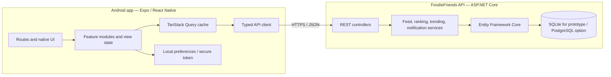

# FoodieFriends Android Client — Software Design Document

> **Version:** 0.2
> **Date:** 2026-10-24
> **Status:** Product-aligned implementation specification
> **Client:** Android-first mobile app
> **Backend:** Existing FoodieFriends ASP.NET Core API

## 1. Purpose and product relationship

This document specifies the Android-first client for the same FoodieFriends product defined in the [Full Production SDD](./FoodieFriends_SDD_Full.md) and [Prototype SDD](./FoodieFriends_SDD_Prototype.md). It is a companion client, not a new or reduced product concept.

FoodieFriends is a social restaurant-review app for casual foodies in Scandinavia: **see what your friends are eating, discover where to go next.** Friend activity, trusted reviews, and local discovery are the reason for the product. The Android client must preserve the web app's countries, locations, social graph, privacy rules, ratings, reviews, rankings, and saved-place behavior. It adapts how people navigate and interact with those features for a phone: a visual, scrollable feed, native gestures, large tap targets, bottom navigation, and system sharing and photo selection.

The website and mobile app share the same product rules and backend contracts. A mobile-only UI decision must not change who can see an item, how feeds are ordered, what a rating means, or how a city scopes discovery. If a rule changes, update the web and mobile SDDs together.

For the OsloMet assignment, the immediate deliverable is a presentable Android prototype using the repository's fictional seeded data. It must demonstrate the product's Scandinavian and social concepts honestly. This is distinct from production readiness; the authentication and media gaps below remain visible limitations.

## 2. Product rules and scope

### 2.1 Product invariants

These rules are shared with the web client and must not be simplified away in mobile:

1. **Scandinavian scope:** Norway, Sweden, Denmark, Finland, and Iceland. The initial selector offers the five primary cities in each country listed in section 6.2.
2. **Location is a default view, not a review restriction:** the selected municipality scopes the home feed's local trends, default discovery results, and rankings. A user can review a restaurant in any supported municipality in the five countries without changing their selected home city first.
3. **Social-first feed:** the feed shows activity by accounts the selected user follows, with reviews and “Want to Try” activity presented in strict created-time order. Trending cards are inserted separately at their configured local time slots; they do not algorithmically reorder friend activity.
4. **One-way follows:** following someone does not require their approval or a reciprocal follow. “Friend activity” means activity from accounts the current user follows.
5. **Review privacy:** reviews are `Public` or `FriendsOnly`. Public reviews can appear in public review lists. Friends-only reviews are only returned to their author and permitted followers. The API enforces this rule.
6. **Comment privacy:** a comment is visible to the review author, the commenter, and a user who follows both the review author and the commenter. The API filters comments; the client never substitutes its own visibility check for server enforcement.
7. **Consistent review semantics:** ratings are 1–10; repeat visits are numbered per user and restaurant; reviews can carry a price range, tags, and up to five photos when upload support is available.
8. **Municipality-scoped rankings:** all-user, followed-users, and category rankings use the selected municipality. Qualification thresholds are in section 6.4.

### 2.2 Assignment prototype scope

- Country and city selection, with the current selection visible and changeable from the main app.
- Home feed with fictional followed-user reviews, followed-user “Want to Try” activity, and city-specific trending cards.
- A visible demo persona switcher so the presenter can demonstrate different follow graphs and privacy perspectives.
- Restaurant discovery scoped to the selected municipality, with an option to widen to its country; cuisine/category, price, “New,” and relevant tags as filters.
- Restaurant profiles with followed-user reviews first and public reviews available separately.
- Review creation/preview with rating, visit number, title, body, price, tags, visibility, and a clear photo-upload limitation if the API cannot accept photos.
- Likes, comments, follows, and saved places wherever the current API supports them; local demo behavior must be visibly identified as simulated.
- Municipality and category rankings, user profiles/search, and an in-app notifications list where the verified backend contract supports them.

The prototype should prioritize a coherent walk-through of location selection → social feed → discovery → restaurant profile → save or review → social feedback. A visibly marked, rule-consistent demo fixture mode is acceptable if the local API is unavailable. It must use fictional people, restaurants, reviews, and social relationships and must never be presented as live service data.

### 2.3 Later production scope

- Server-verified authentication, account recovery, and identity-bound authorization.
- Authenticated image upload, durable media storage, validation, and moderation.
- Push delivery and device registration; the in-app notifications list is separate from push.
- Restaurant-provider integration, payments, public store release, and production observability.
- iOS distribution. Keep the client structure portable, but this SDD's acceptance target is Android.

## 3. Current system baseline and implementation boundary

The repository contains a React/Vite web client, an ASP.NET Core API targeting .NET 10, and an Expo/React Native mobile client. The API uses Entity Framework Core and defaults to SQLite; configuration also supports PostgreSQL. Controllers cover users, follows, restaurants, reviews, feed, rankings, want-to-try, notifications, and locations.

The web SDDs are the product source of truth. Their route lists and examples describe intended behavior; they do not prove that each route, filter, or authorization rule is currently implemented. Before wiring a mobile feature, inspect the matching controller, service, DTO, seeded data, and web API call. Record unsupported behavior as a blocker or explicit prototype limitation rather than fabricating a live result.

Current prototype constraints:

- API identity is simulated through an `X-User-Id` header. A visible persona switcher may use this only in a controlled local/demo build; this is not authentication and must never be exposed as a production identity mechanism.
- The web API client may fall back to seeded mock data. Mobile must not silently mix failed API responses with fixtures. Its API state and fixture/demo state must be distinguishable on screen.
- Production login, authenticated image upload, and push-device registration are not confirmed. Do not imply these work.
- Local preview and Android Expo Go are development paths, not published or installable production builds.

Verified API gaps to account for in the prototype:

- `GET /api/feed` currently selects its trending-card city from the demo user's profile, not from a client-selected city. The mobile client must request trends for its selected city separately or clearly label the API limitation; do not imply that changing the mobile location changes the server feed's trend slot.
- Ranking services currently fall back to one review when no restaurant meets their normal minimum. The all-user service counts reviews without applying a public-only filter, and the followed-users service includes the current user's reviews. These are prototype implementation details that do not satisfy the qualification rules in section 6.4. Keep the intended shared product rules, but surface these discrepancies during implementation and do not describe the API ranking response as fully enforcing them.
- The want-to-try controller is exposed at `/api/want-to-try` (and the controller-name route), not `/api/wanttotry`. Mobile wrappers must use the verified hyphenated route.

The implementation workflow must audit the actual endpoint response shapes, location identifiers, social identity behavior, ordering, pagination, and privacy enforcement before choosing API-backed screens. Keep a decision log when the implementation differs from either web SDD.

## 4. Recommended technology

| Area | Proposal | Notes |
|---|---|---|
| Mobile runtime | React Native with Expo | Native Android UI using the existing React and TypeScript skill base |
| Project framework | Expo SDK 58 in the current project | Keep Expo and its native package versions aligned in the lockfile; check versioned Expo docs before changing SDK APIs |
| Navigation | Expo Router | File-based routes, tab navigation, nested screens, and deep links |
| Language | TypeScript, strict mode | Reuse and adapt existing API data types where contracts match |
| Remote data | TanStack Query | Cache, loading/error state, refetch, and mutation invalidation for API data |
| HTTP | Shared typed API module over `fetch` | No platform-specific storage or `import.meta.env` in shared transport code |
| Local preferences | AsyncStorage | Remember selected country/city and non-sensitive display preferences |
| Credentials | Expo SecureStore after real authentication exists | Never store a production access token in plain preferences storage |
| Photos | `expo-image-picker` | Use the system picker; ask for camera access only when the user chooses to take a photo |
| Notifications | `expo-notifications` for device delivery | Requires backend token registration and server-side delivery work |
| UI styling | React Native `StyleSheet` and shared design tokens | DaisyUI and browser Tailwind classes do not render as React Native components |
| Backend | Existing ASP.NET Core API and EF Core | Keep domain rules and persistence server-side |
| Build and distribution | Local Android build or Expo Application Services (EAS) | EAS is optional; use internal builds before Play testing |

React Native preserves React concepts, JSX, TypeScript, and much of the state and API-layer knowledge while rendering native components. React Native’s current setup guidance recommends using a framework such as Expo for new apps. Expo Router is the recommended navigation approach for new Expo projects. [React Native setup](https://reactnative.dev/docs/environment-setup?guide=native&package-manager=npm), [Expo Router](https://docs.expo.dev/router/introduction/)

## 5. Proposed architecture



### 5.1 Client module boundaries

- **Routes:** screen composition and navigation only.
- **Features:** feed, restaurants, reviews, follows, profiles, rankings, saved places, notifications, and location selection.
- **Data layer:** typed API calls, DTO mapping, query keys, mutations, and error translation.
- **Storage:** selected location and non-sensitive preferences; credentials only after real authentication is implemented.
- **UI kit:** reusable native buttons, rating control, photo grid, restaurant summary, review card, empty states, and loading placeholders.
- **Design tokens:** FoodieFriends coral, cream, saffron, herb-green, charcoal, spacing, type scale, radii, and elevation.

### 5.2 Suggested project layout

```text
src/FoodieFriends.Mobile/
├── app/
│   ├── _layout.tsx
│   ├── (tabs)/
│   │   ├── _layout.tsx
│   │   ├── index.tsx                 # Feed
│   │   ├── discover.tsx
│   │   ├── saved.tsx
│   │   └── profile.tsx
│   ├── restaurant/[id].tsx
│   ├── restaurant/[id]/review.tsx
│   ├── user/[username].tsx
│   ├── rankings.tsx
│   └── notifications.tsx
├── src/
│   ├── api/                          # HTTP client, DTOs, query keys
│   ├── features/                     # Feature-specific hooks and UI
│   ├── components/                   # Shared native components
│   ├── storage/                      # Preferences and secure token adapter
│   └── theme/                        # Color, type, spacing, shape tokens
├── app.json
└── package.json
```

The exact folder names can change during implementation. Keep feature screens independent from the API transport so they can be previewed with fixtures in development without shipping mock fallback behavior.

## 6. Navigation and screen design

### 6.1 Main navigation

Use a persistent, thumb-reachable bottom tab bar for **Feed**, **Discover**, **Review**, **Want to Try**, and **Profile**. The central Review action starts restaurant selection when no restaurant is selected, then opens the review form. Keep the selected country/city and demo persona visible in the feed header and easy to change. Put Notifications in a bell action with an unread badge. Make Rankings reachable from Discover and from the selected-city trends card.

Use stack screens for restaurant and review details, user profiles, rankings, notifications, location selection, and friend search. Preserve Android system back behavior and allow app links for restaurants, reviews, and profiles. Tabs and gestures may differ from the website; route destinations and resulting product behavior must match.

### 6.2 Location setup and switching

On first launch, select a country and then a primary city. Remember both and provide an always-accessible location control. Do not request GPS permission for MVP.

| 🇳🇴 Norway | 🇸🇪 Sweden | 🇩🇰 Denmark | 🇫🇮 Finland | 🇮🇸 Iceland |
|---|---|---|---|---|
| Oslo | Stockholm | Copenhagen | Helsinki | Reykjavík |
| Bergen | Gothenburg | Aarhus | Tampere | Kópavogur |
| Stavanger | Malmö | Odense | Turku | Hafnarfjörður |
| Trondheim | Uppsala | Aalborg | Oulu | Reykjanesbær |
| Drammen | Västerås | Esbjerg | Jyväskylä | Akureyri |

Changing city updates the feed's local-trending card, default discovery results, and rankings together. The app must not show “Loved around Oslo” while another city is selected. The selected city does not constrain the municipality of a review being written; restaurant search in another supported municipality must remain possible.

### 6.3 Screen requirements

| Screen | Main content and behavior |
|---|---|
| Feed | Followed-user reviews and “Want to Try” activity in created-time order; city-trending card at its configured slot; review photos, visit number, rating, price, tags, like/comment actions; pull to refresh and pagination. |
| Discover | Search and category entry; municipality default with a country-wide option; cuisine, price, “New,” and tag filters; restaurant rating, price, new badge, and followed-user activity count. |
| Restaurant | Name, cuisine, address, rating summaries, price, new badge, website/menu links; **Followed users** reviews first, **All public reviews**, photos, and info; save toggle and review action. |
| Review form | Rating 1–10, visit-number title, body validation, price, tags, Public/Friends Only (default Public per Full SDD), and up to five photos only if upload is available. Otherwise show a clear photo-upload limitation. Preview before submit and preserve an accidental-navigation draft. |
| Rankings | Selected municipality, All Users, Followed Users, and category scopes; rank, score, qualifying review count, price, new badge, and restaurant navigation. |
| Want to Try | Current persona's bookmarks, newest first, with remove and restaurant navigation. On other profiles, only the SDD-defined public bookmarks are shown. |
| Profile | Display name, username, avatar, bio, home city, review/follow counts, Follow/Unfollow, and Reviews/Want to Try/Photos sections subject to visibility rules. |
| Friend finder | Username search, city, mutual-follow count, and suggestions derived from accounts followed by the current persona's followed accounts. |
| Notifications | In-app review, comment, like, and Want to Try events; unread state, mark-read actions, and links to the related screen. Push is not implied. |
| Persona switcher | Demo-only switch among fictional seeded users. Show the active identity, clear user-scoped cached data on change, and use it to demonstrate differences in follows and visibility. Hide or replace this control when real authentication exists. |

### 6.4 Shared behavior and qualification rules

- **Feed:** review and bookmark events from accounts the current persona follows are interleaved strictly by `CreatedAt`; no popularity- or recommendation-based reordering. City-trending cards are separate insertions, not feed-sort inputs.
- **FriendsOnly reviews:** only the author and permitted followers receive them from the API. All-review lists contain public reviews only. The UI must label private reviews for their author and must not expose an action that suggests a hidden review is public.
- **Comments:** the server returns only comments visible under the rule in section 2.1. Changing persona must refetch comments and clear the prior persona's cache.
- **Follow:** one tap follows; a second tap unfollows. No reciprocal follow or approval is implied.
- **Visit number:** count this user's previous reviews for the same restaurant and use the next number in the title (for example, “(#2)”).
- **New restaurant:** `OpenedDate` is no more than six months before the current date.
- **Rankings:** All Users requires at least three qualifying public reviews; Followed Users requires at least two reviews from accounts the persona follows. Category ranking is scoped by municipality and category and must follow the verified ranking service's qualification rule.
- **Want to Try:** a bookmark is a personal saved-place state and, when created, a social feed event for that persona's followers.

### 6.5 Mobile interaction rules

- Use a vertically scrolling, photo-forward feed with native-feeling cards, swipeable photo sets, pull-to-refresh, and stable list keys. Do not use a desktop three-column social layout on a phone.
- Keep controls thumb-sized, give like/save/follow/visibility actions clear labels and state, and make private/public state understandable before review submission.
- Respect safe areas, Android system back, keyboard behavior, screen readers, font scaling, and reduced motion.
- Use the Android system photo picker only when the user chooses to attach a photo. Request camera access only if a camera action is offered.
- For the VibeOff browser capture, present the same mobile-first screen in a clean, centered phone-width canvas with no black gutters, browser chrome, or scaffold page. Treat this as a capture layout for the same client, not as a separate desktop product. Acceptance still requires an Android/Expo Go walkthrough.

## 7. API and data contracts

The web SDD documents the intended route families below. The implementation team must verify the exact route attributes, DTO JSON, identity requirements, city identifiers, ordering, pagination, and authorization behavior in the current API before binding screens. Do not present a documented-but-unimplemented route as live.

| Capability | Documented route family | Mobile behavior |
|---|---|---|
| Locations | `GET /api/locations/countries`; `GET /api/locations/cities?country=` | Country and city selector; persist selected IDs. |
| Feed and trends | `GET /api/feed?cursor=&limit=`; `GET /api/feed/trending?city=` | Chronological followed-user events plus separately placed city trends. |
| Restaurants | Search with `q` and `city`; restaurant detail; reviews/friends-reviews; categories; by-category; new | Map verified DTOs; default to selected city, allow country-wide discovery. |
| Reviews | Create/read; like/unlike; get/add comments | Enforce visibility and visit numbering on the API; invalidate affected queries after mutations. |
| Follows | Follow/unfollow; following/followers | One-way follow graph for current persona. |
| Want to Try | List; add/remove a restaurant | Personal saved list and a visible feed event when the API supports it. |
| Users | Me; profile; search; suggestions; reviews; public saved places | Persona/profile views and friend finder; respect review and bookmark visibility. |
| Rankings | All, friends, category | Use selected municipality and verified thresholds from section 6.4. |
| Notifications | List; mark one/all read | In-app notifications and deep links; push is separate. |
| Authentication | Current prototype `X-User-Id` identity | Allow only in an explicitly local/demo build with a visible persona; never describe it as login or use it in a public build. |
| Photo upload | No production upload path confirmed | Existing photos may be displayed; do not claim review photo submission works without a verified upload endpoint. |

The web API helper contains browser-specific `localStorage` and Vite environment access as well as mock fallback behavior. Reuse platform-neutral types only where they match actual API DTOs. Configure the mobile API origin per development environment; use Android emulator host routing or a reachable LAN address as appropriate, and never commit a machine-specific URL or credential. Fixture mode is explicit, fictional, and separate from API errors.

### 7.1 Network and persona state

- Distinguish loading, empty, offline, HTTP error, authorization failure, and fixture/demo content.
- Cache feed and restaurant reads for navigation. Invalidate affected feed, review, follow, comment, and saved-place queries after mutations.
- Clear all user-scoped queries immediately when the demo persona changes; refetch using the selected persona.
- Do not queue review writes offline. Preserve a local draft and offer retry when online.
- Keep the selected country/city as a non-sensitive local preference. Never store production credentials in ordinary preferences.

### 7.2 Android development networking

- Configure API base URL per build profile. Android emulator requests to a developer machine must use the emulator-reachable host; physical devices use a reachable LAN host during local development. Production uses HTTPS.
- Do not commit a machine-specific API URL or expose the local demo API to public networks as a production service.

## 8. Security, privacy, and permissions

### 8.1 Identity and authorization

The current `X-User-Id` middleware is a demo identity mechanism, not login. For the assignment, a visible persona switcher can select among fictional seeded users so the social graph and privacy behavior can be presented. The active persona must be obvious, and changing it must clear user-scoped cache. Do not call it an authenticated account. Before public distribution, replace it with server-verified authentication and derive identity from a verified credential; store that credential in Expo SecureStore and send it only over HTTPS.

The server remains responsible for FriendsOnly review visibility, comment visibility, follow authorization, and ownership checks. Client-side filters may organize content, but are never a security boundary. In fixture mode, reproduce the SDD rules explicitly and keep the data fictional.

### 8.2 Permissions

- **Photos:** request access in context when the user selects Add Photo; prefer the system picker and selected-photo access.
- **Camera:** request only if the user chooses Take Photo. Camera is optional for the first release.
- **Notifications:** request after explaining the benefit, not at first launch. In-app notifications remain available if the user declines.
- **Location:** no GPS permission for MVP; the user selects a city. A later “near me” feature needs a separate consent and retention decision.

Expo ImagePicker provides system image selection and camera access. Expo Notifications can bridge device notification handling, but sending notifications still requires server delivery and device-token management. [Expo ImagePicker](https://docs.expo.dev/versions/latest/sdk/imagepicker/), [Expo Notifications](https://docs.expo.dev/push-notifications/overview/)

### 8.3 Review photo handling

The current data model stores review photo URLs, while a production upload path is not confirmed. Add an authenticated upload flow that validates type and size, strips location metadata unless a clear product need exists, compresses appropriately, stores media outside the API process, and returns durable URLs. The API should enforce the maximum of five photos and attach uploads only to reviews the user owns.

## 9. Non-functional requirements

- **Performance:** render cached content quickly; paginate long feeds; resize image payloads; avoid loading full photo originals in the feed.
- **Reliability:** provide loading, empty, offline, and error UI for every server-backed screen. Network errors must not silently convert into mock content.
- **Accessibility:** content descriptions for meaningful images, labels and state for icon buttons, scalable text, adequate contrast, and screen-reader order that follows visual order.
- **Privacy:** request only needed permissions; explain friend-only content; avoid logging review text, tokens, or private profile data.
- **Compatibility:** choose the minimum Android API level during implementation based on Expo SDK support and the course/device target; validate on at least one emulator and one physical Android device where available.
- **Observability:** log sanitized request failures and crash metadata in release builds; keep personal content and credentials out of logs.

## 10. Prototype acceptance and review

### 10.1 Product-parity acceptance

1. First launch offers all five countries and the 25 primary cities in section 6.2. The selected city is remembered, visible, and changeable.
2. Changing the selected city changes local trends, default discovery, and rankings together. It does not prevent writing a review for a restaurant in another supported municipality.
3. The feed clearly represents the selected persona's followed accounts, mixes review and Want to Try events by created time, and shows city-specific trend content separately.
4. Switching persona visibly changes the follow graph and user-scoped state. Demo identities and content are fictional and clearly marked.
5. Public and FriendsOnly review behavior matches the web SDD. The review author's, commenter's, and shared-follower comment visibility follows section 2.1. API-backed views rely on API enforcement; fixtures demonstrate the same rule.
6. A restaurant page prioritizes followed-user reviews and provides a separate public-review view. New badge, rating, price, tags, visit number, and bookmarks are represented accurately where supported.
7. Rankings use municipality and category scope, with verified qualification thresholds. No sample metric is presented as live service data.
8. Review preview/submit clearly states whether a note was posted and whether photo upload is supported. Demo preview cannot be mistaken for a server submission.
9. Feed, discover, restaurant, saved places, profile, review, and location screens have loading/empty/error/demo states appropriate to their data source.
10. The primary path works on an Android phone or emulator with native-sized controls, safe areas, keyboard behavior, and system back. VibeOff capture uses the same product and does not expose browser chrome, black gutters, scaffold screens, real personal data, or misleading live-service claims.

### 10.2 Verification approach

- Audit API routes, DTOs, seed data, sorting, pagination, identity, and visibility before integration.
- Run the project's available typecheck/build checks and walk the Android demo path manually.
- Check a narrow phone viewport, a larger phone viewport, Android back, keyboard, safe areas, screen-reader labels, and text scaling.
- Review every VibeOff capture image and the accompanying claims before preparing a private draft. Draft creation and publication remain separate actions; never publish automatically.

## 11. Delivery plan

### Phase 0 — Product and API alignment

- Use this SDD and the two web SDDs as the shared product contract.
- Audit the current implementation and API before assigning bounded work packages.
- Decide whether each target screen is API-backed or explicitly fictional fixture mode; do not silently combine them.
- Verify a demo persona strategy and location IDs without adding production credentials or machine-specific URLs.

### Phase 1 — Product-aligned mobile shell

- Keep Expo/React Native in `src/FoodieFriends.Mobile` separate from the web client.
- Implement location selection, persistent city context, visible demo persona, native navigation, and coherent loading/demo/error states.
- Use a phone-first social feed as the main destination, with responsive browser capture support for the assignment.

### Phase 2 — Social discovery path

- Implement the chronological followed-user feed with review and Want to Try items and separate selected-city trends.
- Implement municipality-aware discovery, restaurant profiles with followed-user reviews first, saved places, and rankings.
- Implement review preview/submission states and verified likes, comments, follows, and privacy behavior.

### Phase 3 — Assignment review and VibeOff preparation

- Walk the acceptance path on Android/Expo Go or emulator, then inspect the browser capture layout at VibeOff's target size.
- Use synthetic data only; correct any gap between the implementation, this SDD, and what screenshots claim.
- Follow `ANDROID_PROTOTYPE_WORKFLOW.md` for official capture, image review, draft text review, and explicit draft authorization. Publishing is never automated.

### Phase 4 — Production work (later)

- Add real authentication, server-side authorization tests, upload/storage, push delivery, privacy/compliance work, accessibility and reliability hardening, and store distribution as separately planned work.

## 12. Risks and decisions to confirm

| Decision / risk | Proposed handling |
|---|---|
| Product parity versus mobile-specific experience | Keep product behavior and social rules identical; change navigation, gestures, layout, and device integrations for Android. |
| Identity is currently impersonable through `X-User-Id` | Use only with a visible fictional persona in local demo mode; require real server auth for public release. |
| Current API responses may differ from the web SDD | Audit routes and DTOs before integration; document unsupported behavior rather than inventing contracts. |
| The 25 primary cities are not the boundary of review eligibility | Selected city scopes default views. Preserve review eligibility throughout supported municipalities in the five countries. |
| Review photos have URLs but no confirmed upload service | Display existing/synthetic photos; do not claim new photo uploads until an endpoint is verified. |
| API and client can each contain demo data | Prefer API-seeded fictional data; otherwise use a clearly separated, rule-consistent fixture mode. |
| Push delivery is separate from in-app notifications | Keep the notifications list in MVP where supported; plan push token registration/delivery separately. |
| Category-rank qualification may differ between SDD examples and service code | Verify current ranking service and write down the chosen threshold before implementing rankings. |

## 13. Reuse and migration summary

| Existing web project asset | Mobile plan |
|---|---|
| Product concept, five-country location model, social graph, privacy and ranking rules | Preserve as shared behavior; only interaction design changes for mobile |
| ASP.NET API, Core entities, EF Core data layer, feed/ranking/trending services | Reuse and extend; keep the mobile app a client, not a second domain implementation |
| TypeScript interfaces and endpoint intent | Share/adapt after checking actual JSON DTOs |
| API helper | Refactor into a platform-neutral request layer; replace `localStorage`, Vite env access, and silent mock fallback with native adapters and explicit demo mode |
| React hooks and state transitions | Reuse concepts and pure logic where they have no DOM or browser dependencies |
| Web pages, DaisyUI components, Tailwind classes, React Router | Rebuild with React Native components, Expo Router, and native styles |
| Colors, food photography, labels, and brand voice | Preserve as design tokens and assets |
| Simulated persona switching | Preserve as a visible demo-only feature because it demonstrates the social product; never treat it as production identity |

The mobile client is the same product in a mobile interaction model. Feed composition, geography, reviews, privacy, follows, rankings, and saved-place rules are shared; only screens, navigation, gestures, device integration, and platform release work are mobile-specific.

## 14. References

- [React Native — Get Started](https://reactnative.dev/docs/environment-setup)
- [React Native — Core Components](https://reactnative.dev/docs/components-and-apis)
- [Expo — Develop an app](https://docs.expo.dev/workflow/overview/)
- [Expo Router — Introduction](https://docs.expo.dev/router/introduction/)
- [Expo ImagePicker](https://docs.expo.dev/versions/latest/sdk/imagepicker/)
- [Expo Notifications](https://docs.expo.dev/push-notifications/overview/)
- [Android Developers — App architecture recommendations](https://developer.android.com/topic/architecture/recommendations)
- [FoodieFriends — Full Production SDD](./FoodieFriends_SDD_Full.md)
- [FoodieFriends — Prototype SDD](./FoodieFriends_SDD_Prototype.md)
