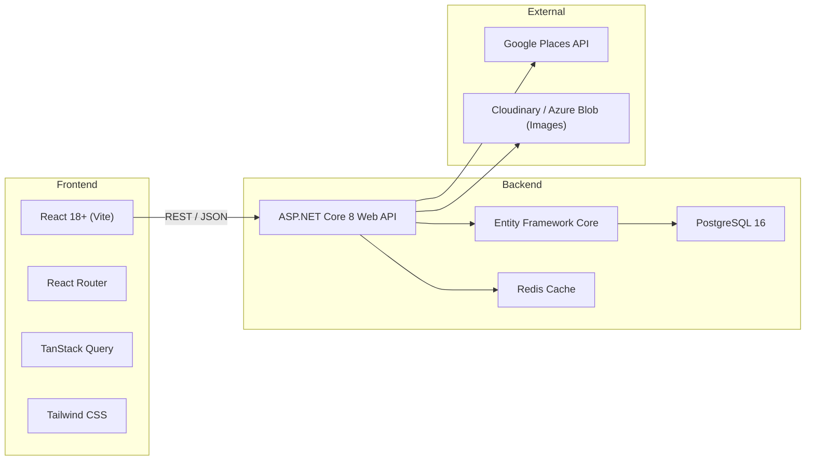
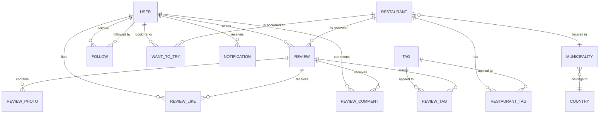
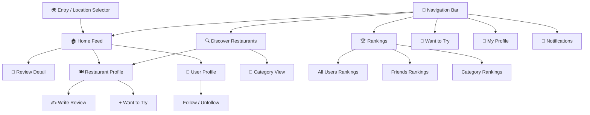
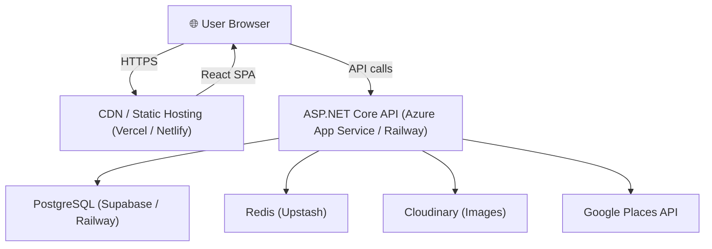

# FoodieFriends — Software Design Document (SDD)

> **Version:** 1.0 · **Date:** 2026-10-24 · **Status:** Draft — Awaiting Review

---

## 1. Executive Summary

**FoodieFriends** is a social restaurant-review web application targeting casual foodies in Scandinavia. It blends the social feed of Instagram with the review depth of TripAdvisor and the ranking utility of Google Reviews. The core experience is a chronological newsfeed showing friends' recent restaurant visits, ratings, and food photos — complemented by restaurant discovery, category rankings, and a "Want to Try" bookmarking system.

### 1.1 Vision Statement

> *"See what your friends are eating, discover where to go next."*

### 1.2 Brand & Identity

| Property | Value |
|---|---|
| **App Name** | FoodieFriends |
| **Logo Concept** | Playful "FF" monogram — the two F letterforms stylised to evoke a fork and knife (or chopsticks), with a subtle plate / bowl curve connecting them |
| **Colour Direction** | Warm, appetising palette — coral/orange primary, cream secondary, dark charcoal text |
| **Tone** | Friendly, casual, food-obsessed |

---

## 2. Technical Architecture

### 2.1 Stack Overview



| Layer | Technology | Rationale |
|---|---|---|
| **Frontend** | React 18+ with Vite | Fast, component-driven UI ideal for social feeds |
| **Routing** | React Router v6 | Client-side navigation with nested layouts |
| **State / Data Fetching** | TanStack Query (React Query) | Caching, pagination, optimistic updates |
| **Styling** | Tailwind CSS | Rapid responsive design, consistent look |
| **Backend API** | ASP.NET Core 8 Web API | C# ecosystem, performant, well-structured |
| **ORM** | Entity Framework Core 8 | Code-first migrations, LINQ queries |
| **Database** | PostgreSQL 16 | Free, robust, excellent JSON & full-text search |
| **Caching** | Redis | Feed caching, trending calculations, session store |
| **Image Storage** | Cloudinary (or Azure Blob) | CDN-backed image hosting with transforms |
| **Restaurant Data** | Google Places API | Addresses, websites, menus, opening hours, photos |

### 2.2 Project Structure

```
FoodieFriends/
├── src/
│   ├── FoodieFriends.Api/           # ASP.NET Core Web API project
│   │   ├── Controllers/
│   │   ├── Services/
│   │   ├── DTOs/
│   │   ├── Middleware/
│   │   └── Program.cs
│   ├── FoodieFriends.Core/          # Domain models, interfaces, enums
│   │   ├── Entities/
│   │   ├── Interfaces/
│   │   └── Enums/
│   ├── FoodieFriends.Infrastructure/ # EF Core, external services
│   │   ├── Data/
│   │   ├── Repositories/
│   │   ├── Services/
│   │   └── Migrations/
│   └── FoodieFriends.Web/           # React frontend (Vite)
│       ├── src/
│       │   ├── components/
│       │   ├── pages/
│       │   ├── hooks/
│       │   ├── services/
│       │   ├── contexts/
│       │   └── assets/
│       ├── public/
│       └── vite.config.ts
├── tests/
│   ├── FoodieFriends.Api.Tests/
│   └── FoodieFriends.Infrastructure.Tests/
├── docker-compose.yml
└── FoodieFriends.sln
```

---

## 3. Data Model

### 3.1 Entity Relationship Diagram



### 3.2 Core Entities

#### User
| Column | Type | Notes |
|---|---|---|
| `Id` | `UUID` | Primary key |
| `Username` | `varchar(30)` | Unique, searchable |
| `DisplayName` | `varchar(100)` | |
| `Email` | `varchar(255)` | Unique (for future auth) |
| `PasswordHash` | `varchar(255)` | Nullable (auth phase 2) |
| `ProfilePhotoUrl` | `text` | |
| `Bio` | `varchar(500)` | |
| `CityId` | `int` | FK → Municipality |
| `SelectedCountryCode` | `char(2)` | Session default country |
| `SelectedCityId` | `int` | Session default city |
| `CreatedAt` | `timestamptz` | |
| `UpdatedAt` | `timestamptz` | |

#### Restaurant
| Column | Type | Notes |
|---|---|---|
| `Id` | `UUID` | Primary key |
| `GooglePlaceId` | `varchar(255)` | From Google Places API |
| `Name` | `varchar(200)` | |
| `Address` | `text` | |
| `Latitude` | `decimal(9,6)` | |
| `Longitude` | `decimal(9,6)` | |
| `MunicipalityId` | `int` | FK → Municipality |
| `WebsiteUrl` | `text` | |
| `MenuUrl` | `text` | Nullable |
| `CuisineType` | `varchar(100)` | e.g. "Italian", "Japanese" |
| `PriceRange` | `smallint` | 1-4 (\$–\$\$\$\$) |
| `AverageRating` | `decimal(3,1)` | Denormalised, recalculated |
| `TotalReviews` | `int` | Denormalised count |
| `OpenedDate` | `date` | Nullable — for "New" badge (≤6 months) |
| `IsActive` | `boolean` | |
| `CreatedAt` | `timestamptz` | |
| `UpdatedAt` | `timestamptz` | |

#### Review
| Column | Type | Notes |
|---|---|---|
| `Id` | `UUID` | Primary key |
| `UserId` | `UUID` | FK → User |
| `RestaurantId` | `UUID` | FK → Restaurant |
| `Rating` | `smallint` | 1–10 stars |
| `Title` | `varchar(200)` | Auto-generated with visit number, e.g. "Amazing sushi (#2)" |
| `Body` | `text` | Min 1 word required |
| `PriceRangeIndicator` | `smallint` | 1-4 |
| `VisitNumber` | `smallint` | Auto-calculated per user×restaurant |
| `Visibility` | `enum` | `Public` / `FriendsOnly` |
| `CreatedAt` | `timestamptz` | |
| `UpdatedAt` | `timestamptz` | |

#### ReviewPhoto
| Column | Type | Notes |
|---|---|---|
| `Id` | `UUID` | Primary key |
| `ReviewId` | `UUID` | FK → Review |
| `PhotoUrl` | `text` | CDN URL |
| `Caption` | `varchar(200)` | Optional |
| `SortOrder` | `smallint` | 1–5 (max 5 photos) |

#### Follow
| Column | Type | Notes |
|---|---|---|
| `FollowerId` | `UUID` | FK → User (who follows) |
| `FolloweeId` | `UUID` | FK → User (who is followed) |
| `CreatedAt` | `timestamptz` | |
| | | Composite PK: (FollowerId, FolloweeId) |

#### WantToTry
| Column | Type | Notes |
|---|---|---|
| `Id` | `UUID` | Primary key |
| `UserId` | `UUID` | FK → User |
| `RestaurantId` | `UUID` | FK → Restaurant |
| `CreatedAt` | `timestamptz` | |
| | | Unique: (UserId, RestaurantId) |

#### ReviewLike
| Column | Type | Notes |
|---|---|---|
| `UserId` | `UUID` | FK → User |
| `ReviewId` | `UUID` | FK → Review |
| `CreatedAt` | `timestamptz` | |
| | | Composite PK: (UserId, ReviewId) |

#### ReviewComment
| Column | Type | Notes |
|---|---|---|
| `Id` | `UUID` | Primary key |
| `ReviewId` | `UUID` | FK → Review |
| `UserId` | `UUID` | FK → User (commenter) |
| `Body` | `text` | |
| `CreatedAt` | `timestamptz` | |

> [!IMPORTANT]
> **Comment visibility rule:** Comments on a review are visible only to (a) the review author, (b) the commenter, and (c) mutual followers of both. This is enforced at the API query level.

#### Municipality
| Column | Type | Notes |
|---|---|---|
| `Id` | `int` | Primary key |
| `Name` | `varchar(100)` | |
| `CountryCode` | `char(2)` | FK → Country |

#### Country
| Column | Type | Notes |
|---|---|---|
| `Code` | `char(2)` | PK — ISO 3166 (NO, SE, DK, FI, IS) |
| `Name` | `varchar(100)` | |

#### Tag
| Column | Type | Notes |
|---|---|---|
| `Id` | `int` | Primary key |
| `Name` | `varchar(50)` | e.g. "Great for dates", "Family friendly", "Best pizza" |
| `Slug` | `varchar(50)` | URL-safe version |

#### Notification
| Column | Type | Notes |
|---|---|---|
| `Id` | `UUID` | Primary key |
| `UserId` | `UUID` | FK → User (recipient) |
| `Type` | `enum` | `NewReview`, `Comment`, `Like`, `WantToTry` |
| `ActorId` | `UUID` | FK → User (who triggered it) |
| `ReviewId` | `UUID` | Nullable FK → Review |
| `RestaurantId` | `UUID` | Nullable FK → Restaurant |
| `IsRead` | `boolean` | Default false |
| `CreatedAt` | `timestamptz` | |

#### TrendingRestaurant
| Column | Type | Notes |
|---|---|---|
| `Id` | `int` | Primary key |
| `RestaurantId` | `UUID` | FK → Restaurant |
| `MunicipalityId` | `int` | FK → Municipality |
| `TrendScore` | `decimal(10,2)` | Calculated score |
| `Period` | `date` | Month of the trend window |
| `CalculatedAt` | `timestamptz` | |

---

## 4. Supported Locations (MVP Scope)

### Initial City Set — 5 Biggest Cities Per Country

| 🇳🇴 Norway | 🇸🇪 Sweden | 🇩🇰 Denmark | 🇫🇮 Finland | 🇮🇸 Iceland |
|---|---|---|---|---|
| Oslo | Stockholm | Copenhagen | Helsinki | Reykjavík |
| Bergen | Gothenburg | Aarhus | Tampere | Kópavogur |
| Stavanger | Malmö | Odense | Turku | Hafnarfjörður |
| Trondheim | Uppsala | Aalborg | Oulu | Reykjanesbær |
| Drammen | Västerås | Esbjerg | Jyväskylä | Akureyri |

> [!NOTE]
> Users can review restaurants in **any municipality** within these 5 countries. The city selector limits the **default view** and rankings — not what you can review.

---

## 5. Application Pages & User Flows

### 5.1 Page Map



### 5.2 Page Descriptions

#### 5.2.1 Entry Page — Location Selector
- **URL:** `/` (first visit or session start)
- Full-screen overlay with the FoodieFriends logo
- **Step 1:** Select country (flags: 🇳🇴 🇸🇪 🇩🇰 🇫🇮 🇮🇸)
- **Step 2:** Select city (top 5 for chosen country)
- Selection stored in session; navigates to Home Feed
- Small "Change location" link persists in the nav bar

#### 5.2.2 Home Feed (Main Page)
- **URL:** `/feed`
- Chronological feed of:
  - **Friend reviews** — card showing: friend's avatar + name, restaurant name + "New" badge if applicable, star rating (1–10), review title with visit number, preview of review body, photo carousel (if any), like & comment buttons, timestamp
  - **Friend "Want to Try"** — lighter card: "[Friend] wants to try [Restaurant]"
  - **Trending in [City]** — inserted card twice daily showing top 3 trending restaurants this month
- Infinite scroll with cursor-based pagination
- Floating action button (FAB): "Write a Review" shortcut

#### 5.2.3 Discover Restaurants
- **URL:** `/discover`
- Search bar with autocomplete (searches local DB + Google Places API)
- Filter pills: Cuisine type, Price range, "New" (opened ≤6 months), Tags
- Category grid: Italian, Japanese, Mexican, Burgers, Fine Dining, Cafés, Seafood, Vegetarian/Vegan, Street Food, **New** (special category), etc.
- Restaurant cards show: name, cuisine, average rating, price range, "New" badge, friend activity snippet ("3 friends reviewed")
- Results default to selected municipality; expandable to country

#### 5.2.4 Restaurant Profile
- **URL:** `/restaurant/:id`
- **Header:** Name, cuisine, address, average rating (all users), average rating (friends), price range, "New" badge, website link, menu link
- **Tabs:**
  - **Friends' Reviews** (default, prioritised) — full review cards from people you follow
  - **All Reviews** — public reviews from all users, sorted by newest
  - **Photos** — gallery of all review photos
  - **Info** — address on map, opening hours, contact, website, menu
- "Write a Review" button
- "Want to Try" bookmark toggle

#### 5.2.5 Write / Edit Review
- **URL:** `/restaurant/:id/review` (or modal overlay)
- Form fields:
  - **Rating:** 1–10 star selector (required)
  - **Title:** auto-prefilled with visit number indicator; editable
  - **Body:** text area (min 1 word required)
  - **Photos:** drag-and-drop upload, max 5, with optional captions
  - **Price Range:** 1–4 selector
  - **Tags:** multi-select from predefined list + custom
  - **Visibility:** toggle — Public / Friends Only (default: Public)
- Submit → creates review → appears on followers' feeds

#### 5.2.6 Rankings
- **URL:** `/rankings`
- **Scope selector:** Municipality dropdown (defaults to session city)
- **Three tabs:**

| Tab | Description |
|---|---|
| **All Users** | Restaurants ranked by average rating from all public reviews; min 3 reviews to qualify |
| **Friends** | Restaurants ranked by average rating from people you follow only |
| **By Category** | Cuisine-type sub-rankings (e.g. "Best Italian in Oslo") |

- Each entry shows: rank #, restaurant name, average score, review count, price range, "New" badge
- Click through to Restaurant Profile

#### 5.2.7 Want to Try List
- **URL:** `/want-to-try`
- Grid/list of bookmarked restaurants
- Sorted by date added (newest first)
- Each card: restaurant name, cuisine, average rating, link to restaurant profile
- Remove bookmark button

#### 5.2.8 User Profile
- **URL:** `/user/:username`
- Display name, profile photo, bio, city
- Stats bar: Reviews count · Following count · Followers count
- Follow / Unfollow button (on others' profiles)
- **Tabs:**
  - **Reviews** — all reviews by this user (chronological), respecting visibility rules
  - **Want to Try** — their public bookmarks
  - **Photos** — gallery of all their review photos

#### 5.2.9 My Profile / Settings
- **URL:** `/profile`
- Edit: display name, bio, profile photo, home city
- Change session city
- (Future: email/password, notification preferences)

#### 5.2.10 Notifications
- **URL:** `/notifications`
- Bell icon in nav with unread count badge
- List of notifications:
  - "[Friend] reviewed [Restaurant]" — links to review
  - "[Friend] commented on your review of [Restaurant]"
  - "[Friend] liked your review of [Restaurant]"
  - "[Friend] wants to try [Restaurant]"
- Mark as read / mark all as read

#### 5.2.11 Friend Finder / Search
- **URL:** `/search` or integrated in nav
- Username search with autocomplete
- Results show: avatar, display name, username, city, mutual followers count
- "Suggested for you" section based on mutual followers (people followed by people you follow)

---

## 6. API Design

### 6.1 RESTful Endpoints

> [!NOTE]
> All endpoints return JSON. Paginated endpoints use cursor-based pagination (`?cursor=xxx&limit=20`).

#### Auth (Phase 2 — stubbed for now)
| Method | Endpoint | Description |
|---|---|---|
| `POST` | `/api/auth/register` | Register with email/password |
| `POST` | `/api/auth/login` | Login, returns JWT |
| `POST` | `/api/auth/logout` | Invalidate token |

#### Users
| Method | Endpoint | Description |
|---|---|---|
| `GET` | `/api/users/me` | Current user profile |
| `PUT` | `/api/users/me` | Update profile |
| `GET` | `/api/users/:username` | Get user profile |
| `GET` | `/api/users/search?q=` | Search users by username |
| `GET` | `/api/users/:username/reviews` | User's reviews (paginated) |
| `GET` | `/api/users/:username/want-to-try` | User's bookmarks |
| `GET` | `/api/users/suggestions` | Suggested users (mutual follows) |

#### Follows
| Method | Endpoint | Description |
|---|---|---|
| `POST` | `/api/follows/:userId` | Follow a user |
| `DELETE` | `/api/follows/:userId` | Unfollow a user |
| `GET` | `/api/follows/following` | List who I follow |
| `GET` | `/api/follows/followers` | List my followers |

#### Restaurants
| Method | Endpoint | Description |
|---|---|---|
| `GET` | `/api/restaurants/search?q=&city=` | Search restaurants |
| `GET` | `/api/restaurants/:id` | Restaurant profile |
| `GET` | `/api/restaurants/:id/reviews` | Reviews for restaurant (paginated) |
| `GET` | `/api/restaurants/:id/friends-reviews` | Friend reviews only |
| `GET` | `/api/restaurants/categories` | List cuisine categories |
| `GET` | `/api/restaurants/by-category/:slug` | Restaurants in category |
| `GET` | `/api/restaurants/new?city=` | New restaurants (≤6 months) |
| `POST` | `/api/restaurants/import` | Import from Google Places |

#### Reviews
| Method | Endpoint | Description |
|---|---|---|
| `POST` | `/api/reviews` | Create review |
| `PUT` | `/api/reviews/:id` | Edit review |
| `DELETE` | `/api/reviews/:id` | Delete review |
| `GET` | `/api/reviews/:id` | Get review detail |
| `POST` | `/api/reviews/:id/like` | Like a review |
| `DELETE` | `/api/reviews/:id/like` | Unlike a review |
| `GET` | `/api/reviews/:id/comments` | Get comments |
| `POST` | `/api/reviews/:id/comments` | Add comment |

#### Feed
| Method | Endpoint | Description |
|---|---|---|
| `GET` | `/api/feed?cursor=&limit=` | Home feed (friend reviews + want-to-try + trending) |
| `GET` | `/api/feed/trending?city=` | Trending restaurants for city |

#### Rankings
| Method | Endpoint | Description |
|---|---|---|
| `GET` | `/api/rankings/all?city=&limit=` | All-users ranking |
| `GET` | `/api/rankings/friends?city=&limit=` | Friends-only ranking |
| `GET` | `/api/rankings/category/:slug?city=` | Category ranking |

#### Want to Try
| Method | Endpoint | Description |
|---|---|---|
| `POST` | `/api/want-to-try/:restaurantId` | Bookmark restaurant |
| `DELETE` | `/api/want-to-try/:restaurantId` | Remove bookmark |
| `GET` | `/api/want-to-try` | My bookmarks |

#### Notifications
| Method | Endpoint | Description |
|---|---|---|
| `GET` | `/api/notifications?cursor=` | My notifications |
| `PUT` | `/api/notifications/:id/read` | Mark as read |
| `PUT` | `/api/notifications/read-all` | Mark all as read |

#### Locations
| Method | Endpoint | Description |
|---|---|---|
| `GET` | `/api/locations/countries` | List countries (5 Scandinavian) |
| `GET` | `/api/locations/cities?country=` | Cities for country |

---

## 7. Key Business Logic

### 7.1 Visit Number Calculation

When a user creates a review for a restaurant:
```
visitNumber = COUNT(reviews WHERE userId = current AND restaurantId = target) + 1
```
If `visitNumber > 1`, the title is auto-annotated: `"[User's Title] (#2)"` — user can override.

### 7.2 Trending Algorithm

Calculated **monthly** via a background job. The trend score uses a weighted formula:

$$\text{TrendScore} = w_1 \cdot R_{30} + w_2 \cdot \bar{S}_{30} + w_3 \cdot W_{30} + w_4 \cdot U_{30}$$

Where:
- $R_{30}$ = number of reviews in the last 30 days (normalised)
- $\bar{S}_{30}$ = average rating of reviews in the last 30 days
- $W_{30}$ = number of "Want to Try" adds in the last 30 days (normalised)
- $U_{30}$ = number of unique reviewers in the last 30 days (normalised)
- Weights: $w_1 = 0.35$, $w_2 = 0.25$, $w_3 = 0.20$, $w_4 = 0.20$

A scheduled job recalculates scores and stores results in `TrendingRestaurant`. The feed injects the top 3 trending restaurants for the user's selected city **twice per day** (morning and evening slots).

### 7.3 "New" Restaurant Badge

A restaurant displays the **"New"** badge when:
```
OpenedDate IS NOT NULL AND OpenedDate >= (TODAY - 6 months)
```

### 7.4 Feed Composition

The feed is **strictly chronological** (no algorithmic sorting). Items are interleaved by `CreatedAt`:

1. **Friend reviews** — reviews from users you follow (public + FriendsOnly)
2. **Friend "Want to Try"** — bookmark events from users you follow
3. **Trending cards** — injected at fixed time slots (e.g. 08:00 and 18:00 local time), pinned at the top if within the scroll window

### 7.5 Comment Visibility

Comments on a review are visible to a user if **any** of these are true:
- The user is the review author
- The user wrote the comment
- The user follows **both** the review author and the commenter (mutual friend connection)

### 7.6 Rankings Qualification

- A restaurant must have **≥3 reviews** to appear in All Users rankings
- A restaurant must have **≥2 friend reviews** to appear in Friends rankings
- Rankings are scoped to **municipality** and **category**

---

## 8. Non-Functional Requirements

### 8.1 Performance
| Metric | Target |
|---|---|
| Feed load (first page) | < 500ms |
| Search autocomplete | < 200ms |
| Review submission | < 1s |
| Image upload | < 3s per image |

### 8.2 Scalability (MVP)
- Target: **10,000 users**, **50,000 reviews** in year 1
- PostgreSQL single instance is sufficient at this scale
- Redis for feed caching and trending score caching
- CDN-backed image storage to offload bandwidth

### 8.3 Responsive Design
- **Mobile-first** responsive web app
- Breakpoints: Mobile (< 640px), Tablet (640–1024px), Desktop (> 1024px)
- Touch-friendly UI elements (fat tap targets, swipeable photo carousels)

### 8.4 Accessibility
- WCAG 2.1 Level AA compliance
- Semantic HTML, ARIA labels, keyboard navigable
- Colour contrast ratios ≥ 4.5:1

### 8.5 Browser Support
- Chrome, Firefox, Safari, Edge (latest 2 versions)
- iOS Safari, Android Chrome

---

## 9. Authentication Strategy

### Phase 1 (MVP — Current)
- **No authentication** — users are created via a simple "Get Started" flow (pick a username, display name, avatar)
- Session-based user identity stored in browser `localStorage`
- This is a prototype/demo approach

### Phase 2 (Post-MVP)
- Email + password registration with BCrypt hashing
- JWT-based API authentication
- Password reset flow
- (Future consideration: BankID / Vipps integration like Hudd for Nordic identity verification)

---

## 10. External Integrations

### 10.1 Google Places API
- **Purpose:** Restaurant data (name, address, coordinates, website, phone, opening hours, photos)
- **Flow:** User searches → API checks local DB first → if no match, queries Google Places → imports and caches result
- **Rate limits:** Managed with request queueing and local caching
- **Menu URL:** If available via Google Places `website` field or extracted from restaurant's website

### 10.2 Image Storage
- **Service:** Cloudinary (free tier: 25GB storage, 25GB bandwidth/month) or Azure Blob Storage
- **Upload flow:** Client → presigned URL → direct upload to CDN → URL stored in DB
- **Transforms:** Auto-generate thumbnails (200×200), medium (600×600), full (1200×1200)
- **Limit:** Max 5 photos per review, max 5MB per image

---

## 11. Development Phases

### Phase 1 — Foundation (Weeks 1–2)
- [ ] Project scaffolding (ASP.NET Core + React + PostgreSQL + Docker)
- [ ] Database schema and EF Core migrations
- [ ] Location seed data (countries, municipalities)
- [ ] Entry page (country/city selector)
- [ ] Basic user creation flow (no auth)
- [ ] User profile page

### Phase 2 — Core Social (Weeks 3–4)
- [ ] Follow/unfollow system
- [ ] User search and friend finder
- [ ] Restaurant search + Google Places integration
- [ ] Restaurant profile page
- [ ] Review creation with photo upload
- [ ] Visit number tracking

### Phase 3 — Feed & Discovery (Weeks 5–6)
- [ ] Home feed with chronological ordering
- [ ] Want to Try bookmarking + feed integration
- [ ] Discover page with categories and filters
- [ ] "New" restaurant badge logic
- [ ] Like and comment system (with visibility rules)

### Phase 4 — Rankings & Trending (Weeks 7–8)
- [ ] All Users rankings (by municipality)
- [ ] Friends-only rankings
- [ ] Category rankings
- [ ] Trending algorithm + background job
- [ ] Trending cards injected into feed
- [ ] Notifications system

### Phase 5 — Polish & Launch (Weeks 9–10)
- [ ] Responsive design refinement
- [ ] Performance optimisation (caching, pagination)
- [ ] Error handling and loading states
- [ ] Logo and brand assets
- [ ] Testing (unit + integration)
- [ ] Deployment setup

---

## 12. Deployment Architecture (MVP)



| Component | Suggested Host | Cost (MVP) |
|---|---|---|
| React Frontend | Vercel / Netlify | Free |
| .NET API | Railway / Azure App Service | Free tier / ~\$10/mo |
| PostgreSQL | Supabase / Railway | Free tier |
| Redis | Upstash | Free tier |
| Images | Cloudinary | Free tier |
| Google Places | Google Cloud | \$200 free credit/mo |

---

## 13. Open Questions & Future Considerations

| # | Question | Status |
|---|---|---|
| 1 | Should we implement real-time feed updates (WebSockets) or keep it pull-to-refresh? | Deferred to post-MVP |
| 2 | Multi-language support (Norwegian, Swedish, Danish, Finnish, Icelandic, English)? | Deferred — English only for MVP |
| 3 | Dark mode? | Nice-to-have for Phase 5 |
| 4 | Restaurant owner claiming & response features? | Explicitly out of scope for now |
| 5 | Push notifications (browser)? | Consider for Phase 5 |
| 6 | Data export / GDPR compliance? | Required for Scandinavia — plan for Phase 5 |
| 7 | Moderation / reporting system for reviews? | Plan for post-MVP |
| 8 | API for the Google Places menu URL — confirm availability | Research during Phase 2 |

---

> [!TIP]
> **Next step:** Review this SDD, flag anything you want changed, and then we move on to coding — starting with Phase 1 (project scaffolding, database, entry page, and user flow).
